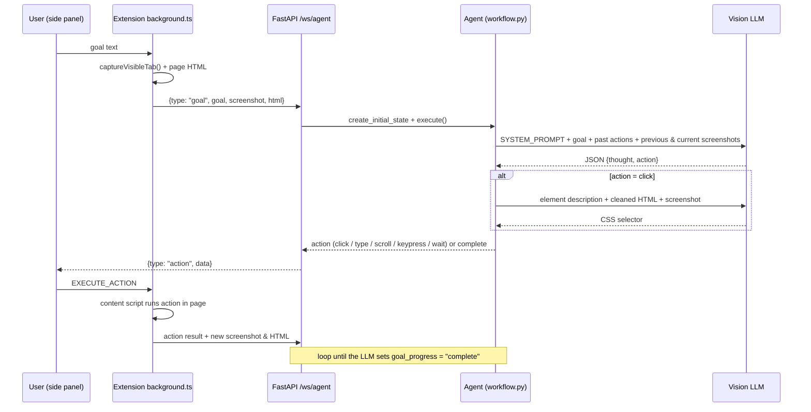

# Surfer AI

A Chrome side-panel extension and Python backend that carry out natural-language browsing goals ("search for python tutorials", "scroll to the bottom") on the page you have open. Each step works like this: the extension takes a screenshot and the page HTML, a vision LLM picks the next action, and the extension performs it in the page.

> **Status:** prototype from Dec 2024 to Jan 2025, no longer actively developed. The default model IDs in [`backend/src/config.py`](backend/src/config.py) are legacy ones (`gemini-pro-vision`, `gpt-4-vision-preview`, `claude-3-opus`). The first two are deprecated by their providers, so you need to set a current vision model through `GEMINI_MODEL` / `OPENAI_MODEL` / `ANTHROPIC_MODEL` (see [`.env.example`](.env.example)). End-to-end runs against a live model were **not** re-verified for this README. The checks that were re-run are listed under [Verification](#verification).

## How it works



1. **Command parsing.** The goal is free text. There is no rule-based parser. The goal goes straight into `SYSTEM_PROMPT` ([`backend/src/prompts.py`](backend/src/prompts.py)), which tells the model to return a strict JSON object `{thought: {goal, previous_actions, current_state, next_step, tentative_plan, goal_progress}, action: {tool: "executor", input: {...}}}`. [`workflow.py`](backend/src/workflow.py) pulls the JSON out of a ```` ```json ```` block, removes trailing commas, and checks the schema.
2. **Vision input.** Screenshots are sent as `image_url` parts through LangChain. The prompt includes every earlier screenshot from the session along with the current one. That is how scrolling decisions like "until you see X" or "to the bottom" are made: the prompt tells the model it has reached the bottom when two screenshots in a row look the same. Scroll behaviour comes from the prompt, not from dedicated code.
3. **Grounding clicks.** The planner describes the element in words only and never gives coordinates. [`tools/element_identifier.py`](backend/src/tools/element_identifier.py) then removes scripts, styles, hidden and empty nodes from the HTML with BeautifulSoup. It sends the description, the cleaned HTML and the screenshot to the LLM again, which returns a short CSS selector.
4. **Execution.** [`tools/action_handler.py`](backend/src/tools/action_handler.py) validates the action and returns it to the extension. [`src/content/content.ts`](src/content/content.ts) performs it in the page: scrolling, clicking via selector, typing into the focused element, dispatching keyboard events, or waiting. After each action the extension sends a fresh screenshot and the HTML back, and the loop runs again.

LLM provider is selected with `MODEL_PROVIDER` = `google` (default) | `openai` | `anthropic` ([`backend/src/llm.py`](backend/src/llm.py)).

## Supported actions

These are the actions the backend accepts. They are the vocabulary the LLM plans with, taken from `ActionHandler.handle_action`:

| Action | Fields | Notes |
|---|---|---|
| `click` | `element_description` | Turned into a CSS selector by a second LLM call |
| `type` | `text` | Types into the focused element. The prompt requires a click on the input first |
| `scroll` | `direction` (`up`/`down`), `pixels` | |
| `keypress` | `key` | Only `enter`, `tab`, `escape` |
| `wait` | `duration` (seconds, > 0) | |
| `complete` | – | Ends the task |

Example goals from the original design: "scroll down 2 times", "scroll to bottom", "scroll to top", "scroll until you see X", "search for python tutorials".

Known gaps: `fetch_user_details` appears in the prompt, but `handle_action` does not dispatch it, so it returns "Unknown action". REST endpoints (`/api/goal`, `/api/action_result`) exist alongside the WebSocket.

## Setup

Requirements: Python 3.11, Node 18+, Chrome.

```bash
# 1. Backend
python3.11 -m venv .venv && source .venv/bin/activate
pip install -r requirements.txt
cp .env.example .env          # add the API key for your provider (+ a current model name)

cd backend/src
PYTHONPATH=..:. uvicorn main:app --port 8000   # the extension connects to ws://localhost:8000/ws/agent

# 2. Extension (separate terminal, repo root)
npm install
npm run build                 # outputs dist/
```

Load `dist/` as an unpacked extension in Chrome (`chrome://extensions`, then Developer mode, then Load unpacked). Click the toolbar icon to open the side panel, then type a goal.

`PYTHONPATH=..:.` is required because the backend imports both `handlers.*` and `src.*`.

## Repository layout

```
backend/src/            FastAPI app (main.py), agent loop (workflow.py), prompts, LLM provider, tools/
backend/eval_benchmarks/screenspot/   ScreenSpot (web split) element-grounding eval harness
backend/scripts/        Selenium driver variant of the agent
src/                    Chrome extension: background.ts, content/content.ts, sidepanel/Sidepanel.tsx
public/manifest.json    Manifest V3 used for the build
```

The ScreenSpot harness ([`backend/eval_benchmarks/screenspot`](backend/eval_benchmarks/screenspot/README.md)) ships the web-split annotations: 436 items in `screenspot_web.json` and 24 in `screenspot_web_sample.json`. It scores a predicted click point against the ground-truth bbox. Images are not included and no evaluation results are committed.

## Verification

Re-checked on 2026-10-29 with Python 3.11 and current PyPI and npm packages, without calling any paid API:

- Backend installs from `requirements.txt` and starts. `GET /` responds, and a WebSocket `{"type":"test"}` returns `Connection test successful`.
- `npm run build` succeeds and produces `background.js`, `content.js` and `sidepanel.js` in `dist/`.
- `backend/eval_benchmarks/screenspot/test_screenspot.py`: 4 passed.
- `backend/tests/test_rest_handler.py::test_action_result_endpoint`: passed. `test_goal_endpoint` calls the LLM and was not run.
- `backend/tests/test_workflow.py` is stale. It imports `WebAutomationWorkflow`, which no longer exists, so collection fails.

## Demo

No screenshots or recordings of the extension in use are committed yet.
